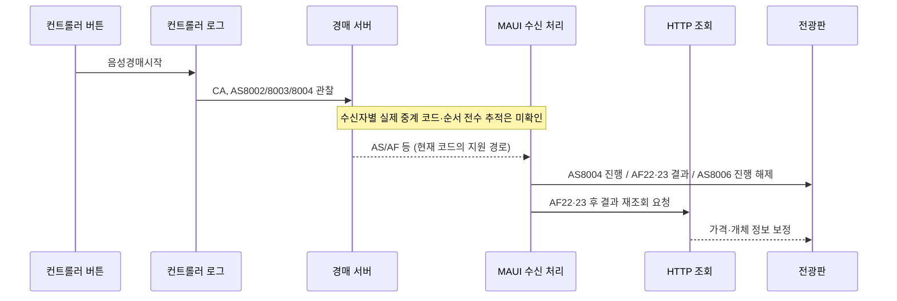

# 단일경매 버튼별 신호 실측

최신 후속: [단일 MAUI 실수신 검증](단일경매_버튼별_MAUI실수신.md)에서 22:56~23:09 업무 경계의 시작·정지·취소·강제 낙찰/유찰·보조 버튼과 모드 복원을 확인했다. 아래는 21시 당시 관찰 기록으로 보존한다.

후속 안내: 22시대에는 **일괄모드**에서 [MAUI 실제 수신](일괄경매_버튼별_MAUI실수신.md)을 재시작 없이 관찰했다. 아래 단일모드 기록의 실측 시각·증거 수준은 그대로 유지하며, 일괄 결과를 단일모드 실제 수신 결과로 바꾸어 쓰지 않는다.

확인일: 2026-09-17, 21:04~21:27 KST. 대상: 실행 중인 `[개발]가축시장 전자경매시스템 v1.3.3`과 CowAuctionMaUI. 가짜 데이터 검증에 대한 사용자 승인을 유지한다. 소스 구현·설정·이름 변경, 원본 WPF 수정, 프로그램 종료, 새 인증 연결은 하지 않았다. 컨트롤러의 회차 종료와 같은 날짜 재진입은 실제 검증했다.

## 읽는 기준

**이 표의 신호는 컨트롤러 로그에서 관찰한 신호다. MAUI가 동일한 패킷을 동일 순서로 받았다고 입증한 표가 아니다.** MAUI의 직접 처리 로그·화면 변화와 코드 경로를 별도로 대조했다. 실제 수신 코드 전수 관찰에는 현재 없는 수신 진단이 필요하다. 이를 숨기고 수신 완료로 표시하지 않는다.

- `관찰 없음`: 버튼 후 약 2.5초 구간에서 `코드|필드` 형태의 로그가 추출되지 않았다. 네트워크 전송이 절대로 없다는 뜻이 아니다. 보류·가격 변경처럼 HTTP/로컬 처리는 성공할 수 있다.
- `코드상`: 신호가 MAUI에 도착했을 때의 처리. 실제 도착 여부를 뜻하지 않는다.
- `조건 제한`: 비활성 버튼, 설정 보존, 프로그램 유지 조건 등으로 확인한 범위가 제한됨.
- 원문 패킷·이름·개체번호·인증값은 기록하지 않는다. `CI ×501`은 이번 가짜 데이터 건수이며 고정 규격이 아니다.
- 기본 내부 대기는 1.8초이며 창 활성화·캡처를 포함한 관찰 구간은 약 2.5초다. 연속 버튼 검사는 직전 음성·타이머 동작이 이어질 수 있어 독립 신호의 부재를 단정하지 않는다.

## 단일경매 모드 확인

환경설정에서 **단일 경매** 선택과 **하나씩 진행** 체크를 확인했다. 저장하지 않고 닫았다. 날짜 선택의 `일괄(한우)`와 메인 화면의 `구분: 일괄`은 이 단일/일괄 진행 방식 설정과 별개다. MAUI 코드의 방식 구분은 `AT[2]=20` 단일 / `10` 일괄이다. 이번 회차 재진입에서 **AT20 로그는 관찰하지 못했다.**

## 주요 경매 버튼

| 버튼·조건 | 실제 조작과 컨트롤러 신호 | MAUI에서 확인한 것 / 코드상 처리 | 증거 ID |
|---|---|---|---|
| `[Space]음성경매시작` / 대기 중 시작 | `CA → AS8002 → AS8003 → AS8004` | 진행 화면 관찰. 코드상 AS8004는 해당 출품·가격을 대조하고 진행 표시를 갱신. CA 직접 처리 없음 | 33, 47 |
| 진행 중 Space | `CU → SD(F,-1)`, 컨트롤러 일시중지 표시 | MAUI에 독립 Pause 상태 없음. CU 직접 처리 없음, SD F 최종 처리 분기는 비어 있음. 전광판이 컨트롤러와 같은 정지 표시를 한다고 보장하지 않음 | 34, 48 |
| 정지 중 Space | 컨트롤러 일시중지 표시 해제. 관찰 구간 내 신호 없음 | 즉시 AS8004를 다시 보낸다고 단정할 수 없음. 음성 재개와 이후 타이머·결과는 별도 단계 | 35, 50 |
| 진행 중 Esc | `CU → CF → SD(F,-1) → AS8002`, 대기 복귀 | 21:13:30.3598 MAUI 종료 반영 로그 확인. 이 로그에 출처 코드가 없어 AF/AS 중 무엇으로 처리됐는지 특정 불가. CF·CU·SD F 자체의 직접 종료 처리기는 없음 | 36 |
| `[F6]강제낙찰/유찰` / 정지 상태 | “카운트다운 혹은 경매 정지 상태에서는 강제낙유찰 처리를 하실 수 없습니다” 안내. 신호 없음 | 실행 거절 사례. MAUI 종료 신호를 기대하면 안 됨 | 49 |
| `[F6]강제낙찰/유찰` / 재개한 무응찰 진행 상태 | `AY → CF → AS8006`, 컨트롤러 보류/유찰 결과. 결과 저장 성공 | 21:17:37.3012/.3459 MAUI 종료 반영. AS8006은 진행 해제이고 낙찰/유찰 결정 자체는 AF/조회 결과 경로와 구분. **응찰이 있는 강제낙찰 분기는 이번 버튼 실측에서 미검증** | 51 |
| `[ENTER]경매시작` | 현재 음성경매 설정에서 비활성. 클릭 후 변화·신호 없음 | 설정을 바꾸지 않아 활성 상태 동작은 미검증 | 46 |
| `[F3]보류` | 첫 클릭은 확인창만 표시. 확인 후 보류 표시, `보류처리 완료` 로그. 관찰 구간 패킷 없음 | AS/AF를 즉시 보낸다고 단정 불가. 실제 보류 처리와 실시간 패킷 부재를 구분 | 37, 38 |
| `회차종료` | 확인창 열기에는 신호 없음. 확인 후 `CH → AS8007`, 날짜 선택 화면으로 복귀 | 21:20:05.5214 MAUI `프로그램 회차 종료`. 코드상 AS8007로 정기 조회 중지. 앱 프로세스는 유지됨 | 60, 61 |
| `프로그램종료` / 창 닫기 | **미실행:** 기존 프로그램을 끄지 말라는 사용자 조건 유지 | 회차종료와 구분. 실제 종료 시 신호는 미확인 | 유지 조건 |

## 목록·대상·가격 버튼

| 버튼 | 실제 동작과 관찰 신호 | MAUI 해석 / 제한 | 증거 ID |
|---|---|---|---|
| `[F1]전체보기` | 전체 목록 팝업. 열기만으로 관찰 신호 없음 | 목록 팝업 개방과 출품 선택 확정은 별도 | 01, 30 |
| 전체보기 행 클릭 | 행 선택. 관찰 신호 없음 | MAUI 진행 출품 변경의 증거 아님 | 31 |
| 전체보기 `[ENT]선택` | 대상 변경 후 `CD → CI ×501 → AS8002` | CI는 MAUI 직접 업무 처리 case가 없음. 서버가 다른 패킷을 보내는지/HTTP 조회 반영인지 별도 확인 필요 | 32 |
| `[F2]보류보기` | 보류 목록 팝업. 처음엔 비어 있었고 F3 확인 후 보류 대상 표시. 열기 신호 없음 | 로컬/조회 목록 변화와 Netty 전송 구분 | 04, 39 |
| 보류보기 `최저가낮춤` | 수정 성공 알림·컨트롤러 성공 로그. 관찰 패킷 없음 | 실제 서버/로컬 수정 성공을 뜻하지만 MAUI 즉시 수신 증거는 아님. 메인 표와 팝업 값의 즉시 동기화까지 확정하지 않음 | 40 |
| 보류보기 `[ENT]선택` | 행 선택만으로는 신호 없음. 확정하면 `CD → CI ×1 → AS8002` | 보류 목록의 1건만 재전송된 사례. 전체보기의 CI501과 구분 | 65~67 |
| 목록 팝업 `[ESC]종료` | 팝업만 닫힘. 메인 프로그램 유지 | 메인 진행 중 Esc 취소와 문맥이 다름 | 01/04/19 팝업 종료 |
| `[F5]새로고침` | `CD → CI ×501 → AS8002`, 새로고침 완료 로그 | **이번에는 AS8001을 관찰하지 못함.** 코드의 AS8001→2초 내 SV 조건부 Refresh를 F5의 실측으로 바꾸어 쓰지 않음 | 06 |
| `[F9]예정가 높이기` | 현재 출품 최저가 증가, `CI ×1`. 이번 송아지 설정에서는 +100 | CI 직접 처리 case 없음. 개체 정보의 후속 HTTP 반영과 직접 패킷 반영은 구분 | 21, 41, 54 |
| `[-]예정가 낮추기` | 현재 출품 최저가 감소, `CI ×1`. 이번에는 -100 | 같은 제한. 가격은 테스트 전 값으로 복원 확인 | 22, 42 |
| 오른쪽 `예정가 낮추기` | 현재 출품 312→212, `CI ×1`. 이후 높이기로312 복원 | 모든 출품을 일괄 변경하는 버튼이라고 추정하면 안 됨. 이번 사례는 현재 대상 1건 | 53, 54 |
| `송아지` / `비육우` / `번식우` | 메인 목록의 축종 대상이 바뀜. 각 관찰 구간 신호 없음 | 진행 방식 AT10/AT20 변경과 다름. 송아지 목록으로 돌아옴 | 27, 28, 29 |
| 상단 `대기/진행/낙찰/보류` 상태 표시 | 각각 클릭해도 상태·신호 변화 없음 | 실제 경매 명령 버튼이라고 취급하지 않음 | 23~26 |

## 음성·전광판·기타 표시

| 버튼·표시 | 관찰 결과 | MAUI 신호에 대한 판단 | 증거 ID |
|---|---|---|---|
| `경매전 인사말` | 클릭 후 프로토콜 로그 없음 | 경매 시작 AS 전송과 혼동하지 않음. 실제 스피커 출력은 별도 계측하지 않음 | 07 |
| `경매 종료 시` | 클릭 후 프로토콜 로그 없음 | 회차종료 CH/AS8007과 다른 버튼 | 09 |
| `안내멘트` | 클릭 후 프로토콜 로그 없음 | 경매 상태 신호 미관찰 | 11 |
| `예비1`~`예비6` | 6개 각각 클릭, 관찰 신호 없음 | 현재 설정·관찰 구간의 결과이며 모든 음성 파일 설정에 일반화하지 않음 | 13~18 |
| `음성중지` | 안내 버튼 사이에 클릭, 관찰 신호 없음 | Space의 CU/SD 정지와 동일하지 않음 | 08, 10, 12 |
| `음성설정` | 음성설정 팝업 열림, 신호 없음. 저장하지 않고 닫음 | 설정 저장/변경 신호는 미검증 | 59 |
| `낙찰결과` | 낙찰 목록 팝업 열림, 신호 없음 | 낙찰을 확정하는 버튼이 아님 | 19 |
| `전광판전환` | `CA → AS8002 → AS8003 → AS8004 → CU → CF → SD(F,-1) → AS8002`를 짧게 관찰 | MAUI21:18:34.4684 종료 반영. 단순 로컬 창 전환으로 분류하면 틀림. 시작/취소 묶음을 서버가 MAUI에 그대로 중계하는지는 미확인 | 58 |
| 우측 `전광판/관전영상/계류대` 표시 | 각각 클릭, 관찰 신호 없음 | 접속 상태 표시를 경매 명령 버튼으로 해석하지 않음 | 55~57 |
| 우측 삼각형/일시정지 아이콘 | 각각 클릭, 대기 상태에서 관찰 신호 없음 | 실제 진행 중 Space와 같은 동작이라고 입증되지 않음 | 44, 45 |
| 순번 체크박스 | 표시 상태 변경, 관찰 신호 없음. 재진입 후 원래 체크 상태 확인 | 음성/표시 항목 설정과 경매 신호를 구분. 다른 체크박스 각각의 동작은 전수 실측하지 않음 | 43 |
| `[F8]환경설정` | 설정 창 열림, 신호 없음. 단일경매/하나씩 진행 확인 후 저장하지 않고 닫음 | 저장·서버초기화·경매 방식 변경은 user.xml 보존 범위에서 제외 | 05 |

## 시퀀스와 수신 경계

세부 필드·무시되는 신호·HTTP 주기는 [수신 처리 코드 대조](단일경매_수신처리_코드대조.md)를 참조한다. 특히 `CU/CF/CA/AY/CI/CD/CH`를 코드에 없는 MAUI 직접 처리기로 설명하지 않는다. API 응답 행의 `SC`와 Netty `SC`도 별개다.

## 직접적인 MAUI 로그 증거

| 시각 | 실제 파일 기록 | 입증 범위 |
|---|---|---|
| 21:13:30.3598 | single-auction-complete, updates=1, clear-running=True | Esc 조작 구간의 종료 반영. 입력 패킷 코드는 특정 불가 |
| 21:17:37.3012 / .3459 | single-auction-complete, updates=1, clear-running=True | F6 결과 구간의 종료 반영. 두 알림의 출처 구분은 미확인 |
| 21:18:34.4684 | single-auction-complete | 전광판전환 구간 종료 반영 |
| 21:20:05.5214 | 프로그램 회차 종료 | 회차 종료 처리 확인 |
| 21:27:47.1850 | API 모니터링 누적2452회 (직전21:17:47은2265회) | 추가 확인에서 조회 루프의 재실행을 입증. 재개를 유발한 수신 코드·시각은 특정 불가 |

21:20:50~52 같은 날짜 재진입의 컨트롤러 로그는 AI·AR·SM·SE·CE·CI501·AS8002를 포함한다. AT20는 관찰하지 못했다. 첫 확인 당시에는 이후 MAUI 진단이 없었으나, 21:29 추가 확인에서 21:27:47의 API 모니터링 기록을 찾았다. 이 로그는 [정기 조회 루프 내부](../../CowAuctionMaUI.Application/Auction/ServerGetData.cs#L223)에서만 출력되므로 조회 루프가 다시 실행된 근거다. 실제 재개를 유발한 수신 코드·시각 및 개별 조회 응답 성공까지는 입증하지 않는다. 같은 확인에서 MAUI TCP 연결은 Established였고 Chrome·컨트롤러·MAUI의 기존 PID와 시작 시각이 유지됐다. 컨트롤러21:17:03.946·21:18:34.372 시작 로그 저장 실패가 있으나 F6 최종 결과 저장은 성공했다.

## 검증 방법·보존·미검증

마우스/키 입력 전에 HWND·PID·전경·가림을 확인했다. JavaFX 팝업은 제목이 없거나 PrintWindow에 내용이 누락될 수 있어 화면 캡처와 실제 전경 HWND를 함께 확인했다. 02·03 시도는 전체보기 팝업이 열린 상태였으므로 유효한 메인 버튼 실측에서 제외하고 04·05로 재검증했다. 63 재진입은 창 핸들이 교체되어 캡처가 실패했지만 실제 동작을 반복하지 않고 새 HWND·로그로 확인했다.

로컬 근거는 Git 제외 `artifacts/single-mode`의 코드/상태만 남긴 JSON, 화면 캡처, 재현 도구다. 개인정보·인증정보가 있는 설정 캡처는 근거 패키지에서 제외했다. 컨트롤러 로그는 CP949 공유 읽기, MAUI 로그는 날짜별 파일을 읽었다. 원문 응답을 새 로그로 저장하지 않았다.

테스트 전 선택 출품과 가격으로 돌아왔고, 시험에 사용한 다른 출품의 최저가도312로 복원했다. **보류·강제유찰 결과는 가짜 경매 검증에 의해 변경되어 남아 있다.** 전체 업무 데이터를 원상복구했다고 표현하지 않는다. Chrome·컨트롤러·MAUI의 기존 PID는 유지했다. source/Debug users.XML 두 파일의 SHA-256은 앞선 검증 시작 시 보관한 값과 최종 비교해 일치함을 확인했다. 이름도 그대로다.

이번 요청은 문서·실측이므로 소스 수정·빌드·자동 테스트·커밋·푸시는 수행하지 않았다. 앞선 수정 작업의 미커밋 변경은 보존했다.

남은 범위: 실제 MAUI 수신 코드·순서의 전수 관찰, 활성 수동 Enter 경매, 응찰 있는 강제낙찰, 설정 저장·초기화, 프로그램 종료, 음성의 실제 소리 계측. 종료·설정 변경은 기존 보존 조건과 충돌하므로 실행하지 않는다. 나머지 미확인 항목을 검증 완료로 표시하지 않는다.
