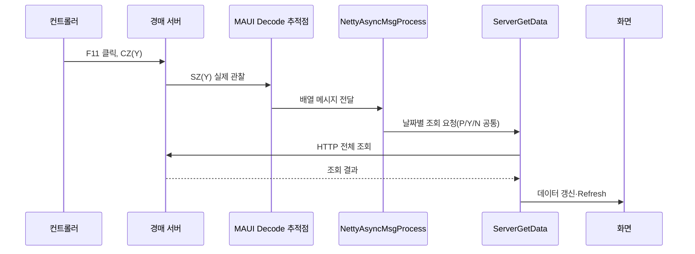

# 일괄경매 버튼별 MAUI 실제 수신

2026-09-17 22:31–22:41 KST. 현재 일괄모드 컨트롤러의 버튼을 직접 클릭하고, **기존 MAUI 프로세스의 Netty 디코더에 도착한 신호**를 Visual Studio 함수 추적점으로 관찰했다. 앱 재시작·소스 변경 없이 검증했다. 컨트롤러 송신과 MAUI 수신은 다르므로 아래 두 열을 구분한다.

이 문서는 현재 **일괄모드** 실측이다. 이전 [단일모드 실측](단일경매_버튼별_실측.md)은 별도 시각·별도 모드의 기록이며, 일괄 결과를 단일모드 실수신 증거로 대신하지 않는다. 메인 화면 `구분: 일괄`만으로 방식을 단정하지 않았고, 재진입 때 MAUI의 **AT10 실제 수신**으로 일괄 방식을 확인했다.

## 관찰 방법과 표기

- `AuctionClientInboundDecoder.Decode` 진입 시 함수 추적점을 사용했다. TLS 해제·줄 단위 프레이밍 뒤, SV/SS를 디코더가 소비하기 전의 수신 경계다. 해당 함수 실행은 계속되도록 설정했다.
- 두 글자 프로토콜 코드, AS 8001–8007, AT 10/20, SZ P/Y/N/A/H, AF 22–24, SD C/F만 저장했다. 패킷 원문·인증·사업장·개체·이름·가격은 저장하지 않았다.
- 버튼 조작 전후 표식을 넣고 컨트롤러 로그와 대조했다. 기본 조작 관찰 구간은 약 2.5초이며, 열린 팝업을 살펴본 구간은 더 길다. 정확한 구간은 [실수신 증거표](일괄경매_MAUI실수신_증거표.md)에 있다.
- 약 5초 주기의 `SS`는 연결 유지 신호다. 표의 업무 신호 순서에서는 제외했다. `없음`은 **관찰 구간에 업무 신호 없음**이며 모든 환경에서 절대 전송하지 않는다는 뜻이 아니다.
- 추적점 평가에 시간이 들므로 이 결과를 정상 운영 지연시간·성능 측정으로 사용하지 않는다. 자동 중단 없이 동작했지만 메시지 처리 타이밍에는 영향을 줄 수 있다.

## 경매 제어·목록 버튼

| 버튼 / 단계 | 컨트롤러 관찰 신호 | MAUI 실제 수신 / 의미 |
|---|---|---|
| 경매시작, 최초 클릭 | 없음, 확인창 | 업무 신호 없음. 확인창 개방과 시작 확정을 구분 |
| 경매시작 → 확인 | CD, CI 196건, CZ(H), CA, AS8002 두 번·8003·8004 | **AS8001 → AS8002 → SZ(H) → AS8002 → AS8003 → AS8004** |
| 경매정지 | CU | **SD**, 재검증에서 **F** 확인. 최초 stop 구간에는 세부 필드를 수집하지 않았고 stop-repeat에서 SD(F)를 확정. MAUI의 일괄 SD 업무 전달 분기는 없음 |
| 정지 후 경매시작, 확인 전 | 없음, 확인창 | 업무 신호 없음 |
| 재개 확인 | CD, CI 196건, CZ(H), CA, AS8002·8003·8004 | **SZ(H) → AS8002 → AS8003 → AS8004**. 이 구간에서는 AS8001이 없었음 |
| 경매종료, 확인 전 | 없음, 확인창 | 업무 신호 없음 |
| 경매종료 → 확인 | CS, CI 41건, AS8006 | **SD(F) → AS8006**. 개체별 AF는 이번 무응찰 종료 구간에서 미관찰 |
| 회차종료, 확인 전 | 없음, 확인창 | 업무 신호 없음 |
| 회차종료 → 확인 | CH → AS8007 | **AS8007**. 날짜 선택으로 복귀, MAUI 정기 조회 중지 경로 |
| 같은 날짜 확인 | 없음, 구간 선택창 | 업무 신호 없음 |
| 기존 구간 1–250 선택 | 별도 컨트롤러 접속·목록 전달 | **AT10 → AS8002**. 같은 프로세스의 일괄 대기 화면으로 복귀 |
| F5 새로고침 | CD, CI 247건, AS8002 | **AS8001 → AS8002**. 컨트롤러 로그만으로 AS8001이 없다고 판단하면 틀림 |
| F1 전체보기 열기 | 없음 | 업무 신호 없음 |
| 전체보기 행 선택 | 없음 | 행 클릭만으로 업무 신호 없음 |
| 전체보기 선택 확정 | CD, CI 247건, AS8002 | **AS8001 → AS8002** |
| F2 보류보기 열기 | 없음 | 업무 신호 없음 |
| 보류보기 행 선택 | 없음 | 행 클릭만으로 업무 신호 없음 |
| 보류보기 선택 확정 | CD, CI 237건, AS8002 | **AS8001 → AS8002**. CI 건수는 테스트 데이터/선택 범위에 따라 달라짐 |
| 팝업의 Esc 종료 | 팝업 닫힘 | 관찰 구간 업무 신호 없음. 메인 프로그램 유지 |
| 메인 프로그램종료 버튼 | 없음, 종료 확인창 | 확인창 개방·취소까지만 검증. **종료 확정은 사용자 창 유지 조건으로 미실행** |

`CA/CU/CS/CD/CI/CH`를 MAUI가 그대로 받았다고 기록하지 않는다. 위 실행에서는 MAUI가 AS/SZ/SD 등의 상태 신호를 받았다. 새로고침·목록 선택의 CI 묶음이 MAUI에 SV 묶음으로 도착한 것도 **이번 실측에서 확인되지 않았다**.

## 상단 F9–F12 표시 버튼

| 실제 버튼 | 컨트롤러 | MAUI 실제 수신 | 현재 클라이언트 처리 |
|---|---|---|---|
| F9 기본 영상 표시 | CZ(A) | **SZ(A)** | 전용 기본 영상 표시 처리 없음 |
| F10 경매대상 표시 | CZ(P) | **SZ(P)** | 지정 날짜 전체 조회 후 화면 Refresh |
| F11 미응찰 표시 | CZ(Y) | **SZ(Y)** | 동일한 날짜 전체 조회 경로 |
| F12 경매결과 표시 | CZ(N) | **SZ(N)** | 동일한 날짜 전체 조회 경로 |
| 시작/재개에 포함되는 표시 명령 | CZ(H) | **SZ(H)** | 전용 H 표시 처리 없음 |

P/Y/N은 `NettyAsyncMsgProcess`에서 같은 날짜 메시지로 변환된다. 이후 `ServerGetData`는 전체 HTTP 조회를 요청한다. **MAUI 안에는 P/Y/N별 개체 필터나 구간 필터가 없다.** 외부 서버가 선택 상태에 따라 다른 응답을 내는지는 이 코드 감사로 확정할 수 없다. 신호 수신 확인과 버튼 의도에 맞는 표시 구현 완료는 별개다.

A/H는 전용 화면 처리가 없지만 모든 SZ 입력이 요청 세대를 변경한다. 진행 중이던 이전 HTTP 응답이 폐기될 수 있으므로 “아무 효과 없이 완전 무시”라고 설명하지 않는다. WPF에도 같은 처리 흐름이 있다.

## 음성·설정·상태 표시

아래 메인 버튼은 각각 클릭했다. 관찰 구간에 MAUI 업무 신호가 없었고, 일부 구간에서 주기적인 SS만 관찰했다.

| 항목 | 확인한 범위 |
|---|---|
| 경매전 인사말 | 클릭. 최초 표식 실패 시도는 제외하고 재검증 |
| 경매 종료 시 | 음성 버튼 클릭. 경매종료·회차종료와 별개 |
| 안내멘트 | 클릭 |
| 예비1, 예비2, 예비3, 예비4, 예비5, 예비6 | 각 버튼 개별 클릭 |
| 음성중지 | 클릭. 경매정지의 SD(F)와 구분 |
| 음성설정 | 팝업 열기·닫기. 저장하지 않음 |
| 낙찰결과 | 낙찰 목록 열기·닫기. 결과 확정 명령이 아님 |
| F8 환경설정 | 팝업 열기·닫기. 저장·초기화하지 않음, 설정 내용 캡처하지 않음 |
| 경매상태 대기/진행/정지/종료 표시 | 각각 클릭. 상태를 바꾸는 명령으로 관찰되지 않음 |
| 종합안내/TV/계류대 연결 표시 | 각각 클릭. 경매 명령으로 관찰되지 않음 |

음성의 실제 스피커 출력은 계측하지 않았다. 설정 저장·서버 초기화, 보류 목록의 대량 최저가 변경, 종료 확정은 이번 수신 검증에서 제외했다. 해당 동작까지 업무 신호 없음으로 일반화하지 않는다. 일괄 UI의 Space/Esc는 [이전 실측](일괄경매_실측_2026-09-17.md)에서 각각 정지하지 않음/프로그램 종료 확인창으로 확인했으며, 단일모드 단축키와 다르다.

## MAUI 내부 흐름

아래 HTTP 요청·응답·화면 갱신은 소스에서 확인한 후속 처리 흐름이다. 디코더 추적점만으로 각 HTTP 응답 성공이나 화면 Refresh 완료까지 증명한 것은 아니다.

- AS8004: 일괄 진행 조회 상태를 활성화한다. 모든 칸을 단일경매 진행 화면으로 강제 전환하는 의미는 아니다.
- AS8006: 일괄 진행 상태 해제, 300ms 지연 후 결과 전체 조회 요청.
- AS8007: 정기 조회 중지. 이후 AS8002 등으로 조회가 다시 허용된다.
- 일괄 AS8001: SV 감지창 2초 개방·요청 세대 갱신·정기 조회 허용. **즉시 전체 조회/Refresh를 실행하는 일괄 AS8001 분기는 없다.** 이번에 SV를 관찰하지 못했으므로 차수 지정 Refresh 실행을 주장하지 않는다.
- AT10/20은 경매 방식이다. UI의 축종/구간 선택과 구분한다.

참조 소스: [디코더](../../CowAuctionMaUI.Infrastructure/Netty/netty/handlers/AuctionClientInboundDecoder.cs), [프로토콜 분기](../../CowAuctionMaUI.Application/Auction/NettyAsyncMsgProcess.cs), [조회·상태 처리](../../CowAuctionMaUI.Application/Auction/ServerGetData.cs), [요청 세대 분류](../../CowAuctionMaUI.Application/Auction/AuctionInput.cs). 현재 소스의 일괄 수명 보완은 앞선 작업이며, 이번 관찰은 재시작하지 않은 기존 실행본이다.

## 검증 종료 상태

같은 날짜·구간·일괄 대기 화면으로 복귀했다. MAUI·Chrome·컨트롤러의 기존 PID/시작 시각을 유지했고, source/Debug `users.XML` 해시가 시작 값과 일치했다. 이름·설정·제품 소스를 수정하지 않았다. 임시 추적점을 삭제하고 **Detach**했으며 DebuggedProcesses=0, Breakpoints=0, 디버거 Design 모드를 확인했다. Stop Debugging으로 앱을 종료하지 않았다.

비식별 근거는 Git 제외 `artifacts/batch-mode/maui-received.txt`와 버튼별 JSON에 있다. 구간 선택 후 창 핸들이 바뀌어 해당 구형 창 캡처만 실패했으나, 같은 동작을 반복하지 않고 새 창·실수신 기록으로 재진입을 확인했다. 이번 문서 작업의 빌드·자동 테스트·커밋·푸시는 미수행이다.
